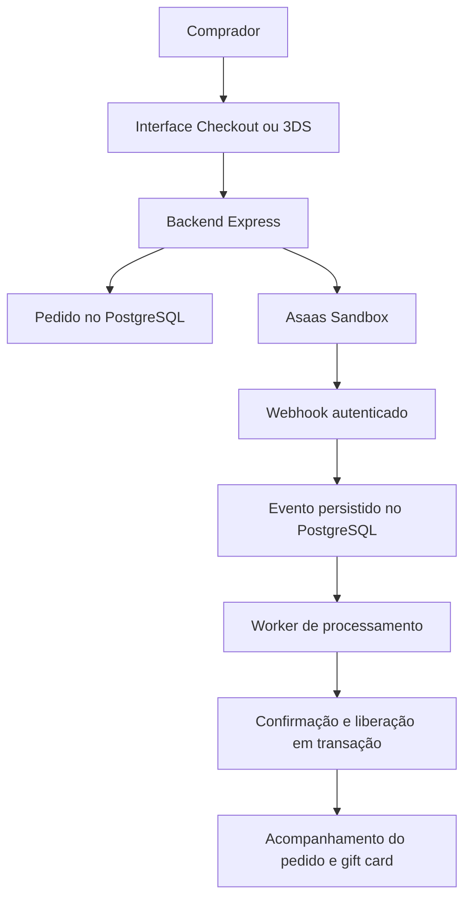

# Secure Digital Checkout

Prova de conceito de venda de um **Gift Card Digital fictício de R$ 100,00**, com integração ao **Asaas Sandbox**. O projeto demonstra a criação de pedidos, dois modelos de pagamento, o acompanhamento de eventos e a liberação de um produto digital após confirmação financeira por webhook.

A aplicação utiliza Node.js com Express, PostgreSQL e uma interface em HTML, CSS e JavaScript puro. Não há fornecedor real de gift cards nem integração com o ambiente de produção do Asaas; a configuração da API restringe as chamadas ao Sandbox.

## Funcionalidades implementadas

- Checkout hospedado no Asaas, com preenchimento do cartão na página do provedor.
- Pagamento direto com cartão e envio de informações para autenticação 3D Secure (3DS).
- Preenchimento automático de dados fictícios para facilitar os testes na interface.
- Página de acompanhamento com status de pagamento, segurança, entrega e histórico do pedido.
- Painel de pedidos com detalhes dos dois fluxos e timeline de eventos.
- Recebimento autenticado de webhooks, persistência dos eventos e processamento por worker.
- Liberação transacional de um código fictício de gift card, com proteção contra eventos duplicados.
- Tratamento de recusa, análise de risco, cancelamento, estorno e falha de autenticação no fluxo direto.

## Como funciona

### Checkout hospedado

1. O comprador informa seus dados pessoais e endereço na página inicial.
2. O backend cria um pedido local e solicita um checkout ao Asaas.
3. A interface apresenta o link para a página de pagamento hospedada pelo Asaas.
4. O comprador informa o cartão nessa página; a aplicação não recebe os dados do cartão nesse fluxo.
5. O evento `CHECKOUT_PAID`, com status `PAID`, confirma o pagamento e permite a liberação do gift card.

### Pagamento direto com 3DS

1. O comprador abre a opção **3DS** e informa dados pessoais, endereço e cartão de teste.
2. O backend busca ou cria o cliente no Asaas e solicita uma cobrança de R$ 100,00 com dados do cartão, informações do dispositivo e callback de 3DS.
3. O ID da cobrança retornado pelo Asaas é associado ao pedido local.
4. Se a resposta contiver uma URL de desafio HTTPS válida, a interface encaminha o comprador para a autenticação no emissor.
5. O evento `PAYMENT_CONFIRMED`, com status `CONFIRMED`, ou `PAYMENT_RECEIVED`, com status `RECEIVED`, confirma o pagamento e permite a liberação do gift card.

A interface apresenta o Sandbox como um ambiente de autenticação automática, sem desafio bancário real. O tratamento de redirecionamento está implementado e é exercitado com mocks nos testes locais.

| Característica | Checkout | 3DS |
| --- | --- | --- |
| Página inicial do fluxo | `/` | `/payments/direct` |
| API do Asaas utilizada | `/v3/checkouts` | `/v3/customers` e `/v3/payments` |
| Onde o cartão é informado | Página do Asaas | Formulário da aplicação |
| Identificador associado ao pedido | `asaas_checkout_id` | `asaas_payment_id` |
| Confirmação financeira | Webhook de Checkout | Webhook de Payment |

### Confirmação e entrega

**Criar um checkout, receber uma resposta de cobrança ou retornar a um callback não libera o produto.** A liberação depende do processamento de um webhook autenticado compatível com o pedido.



O endpoint de webhook valida o token, grava os campos técnicos do evento e responde `200` após a persistência. O worker consulta a fila no PostgreSQL a cada dois segundos e processa confirmação, histórico e entrega em uma transação.

A unicidade do evento do provedor evita reprocessar notificações repetidas. Locks no pedido e uma restrição de entrega única por pedido impedem gerar mais de um gift card para a mesma compra. Pendências sobrevivem ao reinício do servidor; eventos recebidos antes do vínculo com a cobrança aguardam uma nova tentativa de processamento.

O código só é retornado quando o pedido está `CONFIRMED` e a entrega está `RELEASED`. No fluxo direto, recusa, falha de 3DS e cancelamento ou estorno bloqueiam a entrega; uma confirmação tardia não desfaz esses bloqueios.

## Tecnologias e estrutura

- **Backend:** Node.js 18+, Express, Axios, Helmet e dotenv.
- **Banco:** PostgreSQL com `pg`, SQL parametrizado e sem ORM.
- **Frontend:** HTML, CSS e JavaScript puro.
- **Testes:** runner nativo `node:test`, PostgreSQL isolado e mocks do Asaas.

```text
src/
  app.js                 Rotas, arquivos estáticos e tratamento de erros
  server.js              Inicialização do servidor e do worker
  config/                Configuração do PostgreSQL e do Asaas Sandbox
  controllers/           Validação de entrada e respostas HTTP
  middleware/            Autenticação do webhook, HTTPS e limite de tentativas
  routes/                Endpoints da aplicação
  services/              Integração Asaas e regras dos fluxos de pagamento
  repositories/          Persistência, transações e controle de entrega
  public/                Páginas, estilos e scripts da interface
database/
  schema.sql             Estrutura completa para instalação nova
  migrations/            Atualizações incrementais do banco existente
scripts/
  replay-webhook-dev.js   Reenvio local de evento já processado
tests/                   Testes do frontend e de integração
```

## Executar o projeto

### Requisitos

- Node.js 18 ou superior e npm.
- PostgreSQL disponível e um banco criado para a aplicação.
- Conta no Asaas Sandbox e chave de API desse ambiente.
- URL pública para os callbacks e webhooks. O pagamento direto exige HTTPS.

### Instalação e configuração

```bash
npm install
cp -n .env.example .env
```

Preencha o `.env` conforme o ambiente:

| Variável | Finalidade |
| --- | --- |
| `ASAAS_API_KEY` | Chave da API do Asaas Sandbox |
| `ASAAS_BASE_URL` | `https://api-sandbox.asaas.com/v3` |
| `APP_BASE_URL` | URL pública da aplicação; use HTTPS para o fluxo direto |
| `ASAAS_WEBHOOK_TOKEN` | Segredo de 32 a 255 caracteres, sem espaços, igual ao token configurado no webhook |
| `PORT` | Porta HTTP do servidor; padrão `3000` |
| `DB_HOST`, `DB_PORT` | Host e porta do PostgreSQL |
| `DB_NAME`, `DB_USER`, `DB_PASSWORD` | Banco, usuário e senha do PostgreSQL |
| `DB_SCHEMA` | `secure_checkout`, utilizado pelos arquivos SQL do projeto |
| `DIRECT_PAYMENT_TRUST_CLOUDFLARE` | `false` por padrão; habilita confiança nos headers do túnel apenas para conexões locais |

A chave da API e o token do webhook têm funções distintas: a primeira autentica chamadas ao Asaas; o segundo autentica notificações recebidas. O arquivo `.env` não deve ser versionado.

### Preparar o banco

Para uma instalação nova, com o banco `meu_banco` já criado:

```bash
psql -h localhost -p 5432 -U postgres -d meu_banco -v ON_ERROR_STOP=1 -1 -f database/schema.sql
```

Ajuste host, porta, usuário e nome do banco conforme o `.env`. O schema usado pelo DDL é `secure_checkout`.

Para atualizar uma instalação existente, aplique as migrations pendentes em ordem:

```bash
psql -h localhost -p 5432 -U postgres -d meu_banco -v ON_ERROR_STOP=1 -1 -f database/migrations/001_webhook_delivery.sql
psql -h localhost -p 5432 -U postgres -d meu_banco -v ON_ERROR_STOP=1 -1 -f database/migrations/002_webhook_worker.sql
psql -h localhost -p 5432 -U postgres -d meu_banco -v ON_ERROR_STOP=1 -1 -f database/migrations/003_direct_3ds.sql
```

Uma instalação já atualizada até a migration `002` precisa apenas da `003`. As migrations preservam os pedidos existentes e podem ser reaplicadas. O servidor não aplica o schema automaticamente.

### Iniciar a aplicação e configurar o webhook

```bash
npm run dev
```

Para executar sem o reinício automático do nodemon:

```bash
npm start
```

O servidor e o worker iniciam juntos. A interface fica disponível em `http://localhost:3000`, ou na porta configurada.

Configure um webhook no Asaas Sandbox apontando para:

```text
https://SEU_DOMINIO/api/webhooks/asaas
```

Use como token de autenticação o valor de `ASAAS_WEBHOOK_TOKEN`. Habilite os eventos de Checkout (`CHECKOUT_CREATED`, `CHECKOUT_PAID`, `CHECKOUT_CANCELED`, `CHECKOUT_EXPIRED`) e os eventos de cobrança utilizados pelo fluxo direto. Os mapeamentos completos estão em [`src/services/asaasWebhookService.js`](src/services/asaasWebhookService.js).

Para desenvolvimento com Cloudflare Tunnel, publique a porta do servidor e use essa URL em `APP_BASE_URL`. Configure `DIRECT_PAYMENT_TRUST_CLOUDFLARE=true` somente quando o `cloudflared` executa no mesmo host e se conecta ao Node por loopback. Nessa topologia, o backend usa `CF-Connecting-IP` e `X-Forwarded-Proto` para identificar o IP do comprador e a conexão HTTPS. Outras topologias exigem ajuste da integração de proxy.

### Usar os formulários de demonstração

- **Checkout:** o botão **Preencher automático** completa os dados pessoais e o endereço. O cartão é informado posteriormente no Asaas.
- **3DS:** os botões **Aprova** e **Rejeita** completam os dados pessoais, o endereço e o cartão de teste. Eles apenas preenchem o formulário; o envio depende do botão de pagamento.

| Preset no 3DS | Número do cartão | Titular | Validade | CVV |
| --- | --- | --- | --- | --- |
| Aprova | `4444 4444 4444 4444` | João da Silva | `12/2028` | `123` |
| Rejeita | `5184019740373151` | João da Silva | `12/2028` | `123` |

Os nomes dos presets identificam os cenários de teste pretendidos. O resultado efetivo depende do processamento no Sandbox e dos eventos recebidos; os botões não simulam confirmação ou recusa localmente. Utilize somente dados fictícios.

## Páginas e endpoints

| Método | Rota | Função |
| --- | --- | --- |
| GET | `/` | Formulário do Checkout hospedado |
| GET | `/payments/direct` | Formulário de cartão com 3DS |
| GET | `/order/:publicId` | Acompanhamento e entrega do pedido |
| GET | `/admin/orders` | Painel de pedidos |
| GET | `/checkout/success`, `/checkout/cancel` | Retorno do Checkout; consulta o pedido |
| GET | `/payments/3ds/callback` | Retorno do 3DS; consulta o pedido |
| POST | `/api/checkout` | Cria pedido e checkout hospedado |
| POST | `/api/payments/direct` | Cria tentativa de pagamento direto |
| POST | `/api/webhooks/asaas` | Recebe notificações autenticadas |
| GET | `/api/orders/:publicId` | Consulta status e entrega autorizada |
| GET | `/api/admin/orders` | Lista pedidos |
| GET | `/api/admin/orders/:publicId` | Consulta detalhes e histórico |

## Segurança e consistência

O fluxo direto recebe os dados do cartão transitoriamente. Os campos são limpos no frontend antes de aguardar a resposta e ao sair ou retornar à página. Dados de cartão, CVV, tokens e payload bruto do provedor não são persistidos no banco; as respostas e os logs desse fluxo usam campos e categorias explícitos. Os presets são dados fictícios presentes no código da interface.

O webhook utiliza o header `asaas-access-token` e comparação de segredo com `timingSafeEqual`. O vínculo financeiro usa o ID técnico do checkout ou da cobrança persistido no pedido, sem associar eventos por CPF ou apenas por `externalReference`.

O pagamento direto tem limite de cinco requisições por IP a cada dez minutos e teto global de 30 nesse período. Cada página gera um UUID de tentativa, utilizado para impedir cobranças repetidas com o mesmo identificador. O timeout de criação da cobrança é de 65 segundos e não há repetição automática dessa chamada.

Em resultados incertos, a entrega permanece bloqueada e o pedido deve ser consultado antes de uma nova tentativa. Caso o Asaas crie a cobrança e a resposta com seu ID se perca, a associação exige reconciliação manual.

## Testes

As suítes de integração usam um PostgreSQL isolado com o nome **`secure_checkout_test`** e mocks do Asaas, sem chamar a API externa ou ler o `.env`. Com esse banco disponível:

```bash
DB_HOST=127.0.0.1 DB_PORT=55439 DB_NAME=secure_checkout_test DB_USER=SEU_USUARIO npm run test:integration
```

O schema necessário é aplicado pelos testes. A suíte cobre os dois fluxos, payload 3DS, autenticação do webhook, duplicidade e concorrência, transições de status, entrega, timeout, recusas, estorno, callbacks, rate limiting e tratamento de dados sensíveis.

O teste do frontend de pagamento direto também pode ser executado sem PostgreSQL:

```bash
node --test tests/direct-payment-frontend.test.js
```

Para verificar o tratamento de duplicidade com um evento real já processado, com o servidor local iniciado e o `.env` configurado:

```bash
NODE_ENV=development node scripts/replay-webhook-dev.js ID_REAL_DO_EVENTO
```

O script reenvia o evento ao endpoint local e não cria uma nova cobrança. Testes com mocks verificam o comportamento da aplicação; não representam homologação externa do Asaas ou de um desafio bancário.

## Escopo e limitações

Esta é uma demonstração em Sandbox, com produto fictício, preço fixo e pagamento direto à vista. Não implementa parcelamento, tokenização reutilizável ou reconciliação automática de cobranças com resultado incerto.

O painel administrativo não tem autenticação. Embora não retorne o código do gift card, ele lista identificadores que permitem acessar a página pública de acompanhamento. O projeto não implementa controle de acesso por comprador.

Rate limiting e compartilhamento de buscas de clientes são locais ao processo Node. A fila de webhooks é durável no PostgreSQL, mas não há painel de alertas para pendências antigas. Cancelamento, estorno ou chargeback bloqueiam consultas futuras ao código, sem recuperar um produto já visualizado ou consumido.

A captura direta de cartão exige avaliação do escopo PCI DSS antes de qualquer uso real. O projeto não declara conformidade PCI DSS nem comprova transferência de responsabilidade por 3DS.
